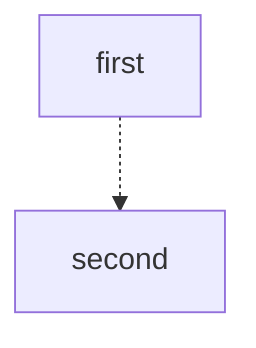

# Datum diagrams

Every blog diagram ships in two versions that say the same thing:

1. **Designed image** (default view): brand components, hand-placed SVG, rendered to a 2x PNG.
2. **Text diagram** (hidden until opened): plain monospace Mermaid for the engineer crowd. It is deliberately simpler than the image and is not meant to match it.

## Colour and style rule (applies to both)

- Outer panels stay grey: hairline `#c4c6c9` with a header strip. Never a moss outer frame.
- Moss `#e6f59f` frames or fills go on Datum content only: load balancer, instances, router, network, servers.
- Outside systems and third-party things are grayscale. Keep original third-party logos (Fly.io, Railway, Google Cloud, Vultr, nginx) when the source diagram had them.
- Failures are clay (`#bf9595` line, `#f5e8e8` fill). Good outcomes are pale moss `#f3f8dd` with a pine `#4d6356` line.
- One line weight per diagram. Arrows are dashed: navy `#223143` neutral, pine ok, clay bad. Edge labels are dark mono tags.
- Brand colours: midnight-fjord `#0c1d31`, pine-forge `#4d6356`, aurora-moss `#e6f59f`, canyon/blush `#bf9595`, silver `#c4c6c9`, glacier `#f6f6f5`. Source of truth: `src/static/styles/variables.css` and `/brand/color`.
- Use the official component artwork (below) instead of drawing lookalikes whenever it exists.

## Designed image workflow

1. Read the source diagram or text. Keep its content and structure; restyle, do not redesign.
2. Add a function to a module like `examples/diagrams.mjs` using the helpers in `kit.mjs`:
   - `extFrame(x, y, w, h, title)` grey outer panel; `tile(cx, y, w, h)` moss frame for one Datum component.
   - `ext(cx, cy, name)` grey diamond (uses official artwork for `router`, `cloud`, `hub`, `lock`, my own line icon otherwise); `datum(cx, cy, name)` pine disc for a Datum component.
   - `rack(cx, cy)` official server stack; `logo(cx, cy, name)` third-party logo crop (`fly`, `railway`, `google`, `vultr`, `nginx`).
   - `line(points, kind, opts)` dashed orthogonal arrow (`ok`, `neutral`, `bad`, `link`); `tag`, `label`, `badge`, `text`.
   - `deco(assetNumber, x, y, w)` brush accents from the official export, for simple diagrams only (3, 4 scribbles; 6 swoosh; 12 squares; 5 swirl; 11 triangles).
3. Render and look at the PNG before saying it is done:
   `node .claude/skills/datum-diagram/render.mjs out-dir path/to/module.mjs [functionName ...]`
4. Check: arrowheads end at box edges (not under a moss border), no label sits on a box, nothing overflows its panel, grey and moss follow the rule.

### Official components in `assets/`

Exported from the Figma "Components - Diagram" file (PNG inside SVG). Complex set: 24 cloud, 25 converge, 26 lock, 31 router (grey diamonds); 32 and 33 user avatars, 34 attacker; 35 shield, 36 firewall, 37 router icons; 38 server stack. Simple set: 3, 4 moss scribbles; 5 grey swirl; 6 clay swoosh; 7 ellipse outline, 8 filled moss ellipse; 9, 10 circles (10 is the pine Datum core); 11 clay triangles; 12 squares; 13 users icon, 14 shapes icon; 17, 18 mono label boxes; 20 WAF, 21 DDoS, 22 rate-limit blobs. The originals live in the designer's export (`~/Downloads/Components - Diagram`); larger or unused pieces were left out of this folder.

## Text diagram (Mermaid) workflow

- Theme: `src/plugins/mermaidBrandTheme.mjs`. Monospace, 1px lines, dashed arrows, straight edges. Tag nodes `:::datum`, `:::ext`, `:::ok`, `:::bad`. Use `linkStyle` for clay or navy arrows.
- Keep one idea per diagram, short labels, no decoration. Examples in `examples/mermaid/`.
- Render to check: `node .claude/skills/datum-diagram/render-mermaid.mjs examples/mermaid out-dir`
- Blog bodies are rendered by `renderMarkdownWithExpressiveCode`; a ```mermaid fence becomes `<pre class="mermaid">` (see `src/plugins/rehypeMermaid.ts`) and the lightbox opens it zoomed.

## Putting both versions in an article

In the Strapi body, write the designed image, then the Mermaid fence directly after it:

````



````

`src/plugins/rehypeMermaid.ts` turns that pair into an "Illustrated | Mermaid" tab set (`src/components/DiagramTabs.astro`, `components-diagram-tabs.css`). Illustrated shows on landing; the Mermaid panel renders off-screen and appears when its tab is chosen, with a "Copy Mermaid" button. The caption sits under both. A mermaid fence with no image right before it renders alone, as before.

## Mermaid layout rules

- Aim for a natural width under about 650px (it scales to the article column; narrower reads better on a phone). Stack panels and steps top to bottom.
- Stack panels with a root `flowchart TB` plus invisible `a ~~~ b` links.
- A subgraph's own `direction` is ignored as soon as an edge crosses its boundary. To get a tall column of nodes that all link to one hub, use a root `flowchart LR` and link each node individually (see `examples/mermaid/landAnything.mmd`). Do not link the subgraph itself.
- Request flows read best as a real `sequenceDiagram` (see `examples/mermaid/requestFlow.mmd`); the theme styles them.
- Do not put a diagram's grey outer panel in Mermaid as a coloured node: panels are subgraphs (dashed grey), moss is for Datum nodes only.

## Examples

- `examples/diagrams.mjs`: the seven IPv6 article diagrams (designed).
- `examples/desktop-article.mjs`: the two Datum Desktop article diagrams (direct vs relay, request flow).
- `examples/five-articles.mjs`: four-flavors, Galactic VPC (land anything, private by default), every-agent-needs-an-edge, network-vs-compute.
- `examples/mermaid/`: the matching Mermaid versions.

## Gotchas learned

- Mermaid draws nodes above edges; thick node borders hide arrowheads. Keep node strokes thin.
- `curve: step` with duplicate end points orients arrowheads sideways on vertical edges; use `linear` (the default here) or `stepAfter`.
- Mermaid `look: handDrawn` does not apply to sequence diagrams and was dropped.
- Zero-length path segments (identical consecutive points) draw nothing: `line()` de-duplicates them.
- Strapi bodies: publishing is outward-facing. Draft first, ask before publishing.
- After publishing, check the live page on the plain URL several times. Right after a deploy the site can serve the build-time article cache; re-saving the published article in Strapi (or re-publishing in the admin) re-fires the revalidation webhook.
- The Mermaid theme is read when the Astro server starts; restart the dev server to see theme changes.

## Facts to check before drawing

See `reference/datum-glossary.md`. It is a starting point, not a source of truth: confirm against https://www.datum.net/docs before stating a technical fact in a diagram.
